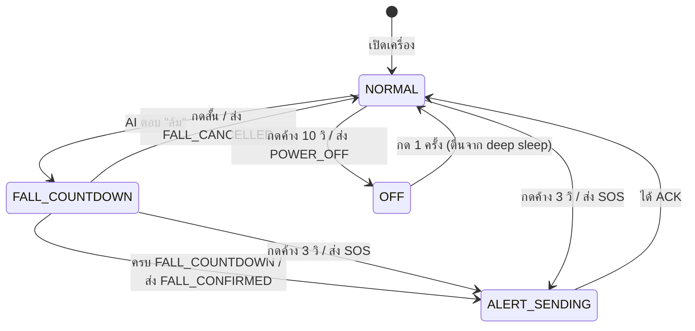
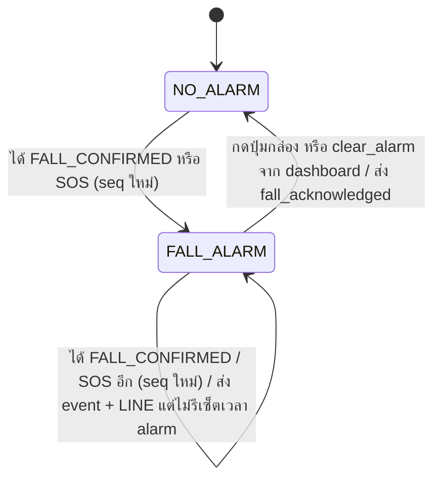
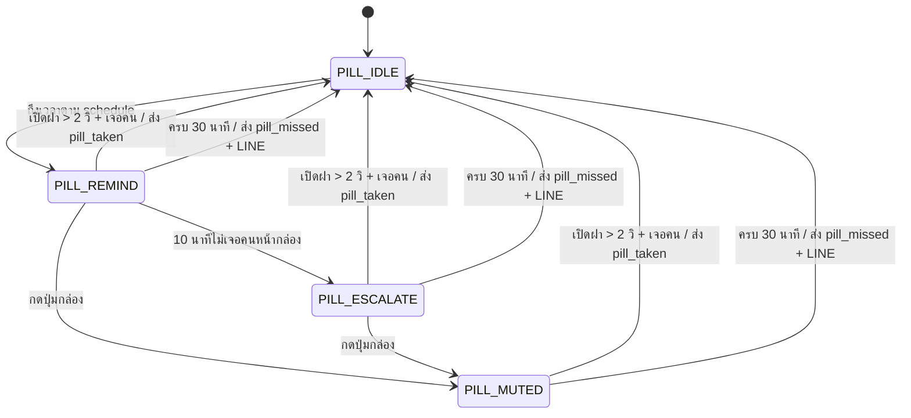
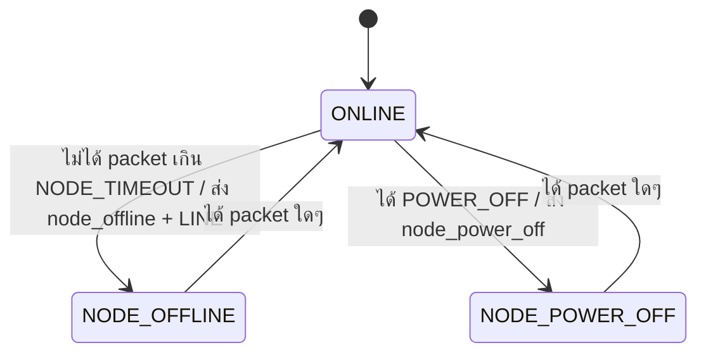

# State Diagram

> spec ที่ System Architect กำหนด ชื่อ packet / field / ค่าคงที่ ตาม [message-format.md](message-format.md) และ [netpie-schema.md](netpie-schema.md) เป๊ะ
> หลักการทำงานเต็มๆ อยู่ใน [system-flow.md](../../system-flow.md)

## กฎการกดปุ่มบนกำไล (ใช้กับทุก state)

ตัดสินตอน **ปล่อยปุ่ม** ยกเว้นกดค้างครบ 10 วิ

| กดค้างนาน | ผล |
|---|---|
| < `SOS_HOLD` (3 วิ) | กดสั้น |
| ≥ `SOS_HOLD` แล้วปล่อยก่อน 10 วิ | SOS (ครบ 3 วิ มอเตอร์สั่นสั้น 1 ที บอกว่า "ปล่อยได้แล้ว") |
| ครบ `POWER_OFF_HOLD` (10 วิ) | ปิดเครื่องทันทีโดยไม่ต้องปล่อย |

เหตุผล: ถ้าส่ง SOS ทันทีที่ครบ 3 วิ คนที่ตั้งใจกด 10 วิเพื่อปิดเครื่องจะส่ง SOS ทุกครั้ง

---

## กำไล (sensor node)

| state | ทำอะไร | ไม่สนอะไร |
|---|---|---|
| NORMAL | อ่าน IMU + รัน AI, ส่ง STATUS ทุก `STATUS_INTERVAL`, ACK มี `CMD_PILL_REMIND` → สั่น 3 ครั้ง, ACK มี `CMD_FALL_CLEARED` → สั่นยาว 1 ครั้ง (บอกผู้สวมว่ามีคนรับเหตุแล้ว) | — |
| FALL_COUNTDOWN | มอเตอร์สั่นตลอด นับ `FALL_COUNTDOWN` | ผล AI ใหม่, คำสั่งเตือนยา, กดค้าง 10 วิ |
| ALERT_SENDING | อ่านชีพจรครั้งเดียว แล้วส่ง FALL_CONFIRMED หรือ SOS ซ้ำทุก `ACK_TIMEOUT` จนได้ ACK (ไม่ได้ ACK หลายรอบ → `espnow_link` scan channel เอง) | ผล AI ใหม่, ปุ่มทุกแบบ (ยกเลิกจากกำไลไม่ได้แล้ว ต้องเคลียร์ที่กล่อง) |
| OFF | ส่ง POWER_OFF (retry ≤ 5) แล้ว deep sleep | ทุกอย่าง |

หลังได้ ACK กำไลกลับ NORMAL ทันที ไม่ต้องรอให้ alarm ที่กล่องถูกเคลียร์ (ถ้าล้มซ้ำก็ส่งใหม่ได้)

---

## กล่องยา (gateway)

กล่องมี **2 เครื่อง state วิ่งพร้อมกัน** (ตัวแปร 2 ตัว) แล้วค่อยเลือกว่าจะโชว์อะไรตามลำดับความสำคัญ
แบบนี้ล้มระหว่างเตือนยาไม่ทำให้ตารางยาพัง

### 1. Fall alarm

- เข้า FALL_ALARM: ส่ง event `fall_confirmed` หรือ `sos` + LINE ทันที, buzzer ถี่ 0–2 นาที แล้วสั้นๆ ทุก 15–30 วิ, ครบ 10 นาทีส่ง LINE เตือนซ้ำ 1 ครั้ง
- ออก: ส่ง `fall_acknowledged` (`by` = "button" / "dashboard", `after_s`) + LINE, และใส่ `CMD_FALL_CLEARED` ใน ACK ถัดไปที่ส่งให้กำไล (ครั้งเดียว)
- FALL_CANCELLED: แค่ส่ง event `fall_cancelled` ขึ้น cloud ไม่เปลี่ยน state

### 2. ตารางยา

- เข้า PILL_REMIND: ใส่ `CMD_PILL_REMIND` ใน ACK ของ STATUS ถัดไป (ครั้งเดียว) และอีกครั้งตอนเข้า PILL_ESCALATE
- เวลา 30 นาทีนับจากเวลาในตาราง ไม่รีเซ็ตเมื่อเปลี่ยน state ย่อย
- **ปุ่มกล่องตอนเตือนยา = ปิดเสียง (mute) ไม่ใช่ "กินแล้ว"**: ปิด buzzer, LED ฟ้าค้าง (ไม่กะพริบ), ไม่ escalate อีก แต่ยังรอเปิดฝาอยู่ ถ้าครบ 30 นาทีไม่เปิดฝาก็ยังนับเป็น `pill_missed`
  เหตุผล: กดปุ่มไม่ได้พิสูจน์ว่ากินยา หลักฐานจริงคือ reed + ultrasonic และไม่ต้องเพิ่มชื่อ event ใหม่
- `box_state` ใน shadow ไม่มีค่า muted: ตอน PILL_MUTED ส่ง `pill_remind`

### 3. ลำดับความสำคัญ (สิ่งที่โชว์ + `box_state`)

ไล่จากบนลงล่าง เจออันแรกที่เป็นจริงก็ใช้อันนั้น

| ลำดับ | เงื่อนไข | `box_state` | LED | Buzzer |
|---|---|---|---|---|
| 1 | FALL_ALARM | `fall_alarm` | แดงกะพริบ | ตาม fall alarm |
| 2 | PILL_ESCALATE | `pill_escalate` | ฟ้ากะพริบ | ดังถี่ |
| 3 | PILL_REMIND / PILL_MUTED | `pill_remind` | ฟ้ากะพริบ / ฟ้าค้าง | สั้นเป็นระยะ / เงียบ |
| 4 | ร้อน/ชื้นเกิน | `storage_warn` | เหลือง | เงียบ |
| 5 | เน็ตหลุด | `idle` | เหลือง | เงียบ |
| 6 | ปกติ | `idle` | เขียว | เงียบ |

**กรณีซ้อนกัน**

| เหตุการณ์ | ผล |
|---|---|
| ล้มระหว่างเตือนยา | fall alarm ชนะ เสียง/ไฟเตือนยาหยุด แต่เวลา 30 นาทียังเดิน ถ้าเปิดฝาก็ยังได้ `pill_taken`, ครบ 30 นาทีก็ส่ง `pill_missed` ตามปกติ, เคลียร์ alarm แล้วถ้ายังอยู่ใน 30 นาทีกลับไปเตือนยาต่อ, ไม่ส่ง `CMD_PILL_REMIND` ระหว่าง alarm |
| กดปุ่มกล่องตอนมีทั้ง alarm และเตือนยา | เคลียร์ fall alarm อย่างเดียว กดอีกครั้งถึงจะ mute เตือนยา |
| SOS ระหว่างนับถอยหลังล้ม (กำไล) | ยกเลิกนับถอยหลัง ส่ง SOS ทันที (ไม่ส่ง FALL_CANCELLED) |
| SOS / ล้มซ้ำ ตอนกล่อง alarm อยู่แล้ว | ส่ง event + LINE ของอันใหม่ ไม่รีเซ็ตเวลา alarm |
| เน็ตหลุดระหว่าง alarm | alarm ที่กล่องทำงานปกติ (ไม่ต้องใช้เน็ต), event และ LINE เข้า `store_forward` ส่งตามทีหลังพร้อม "(ส่งช้า ...)", เคลียร์ได้จากปุ่มกล่องอย่างเดียว |
| กำไลขาดการติดต่อระหว่าง alarm | alarm ยังอยู่ ส่ง `node_offline` ตามปกติ |
| ถึงเวลายาตอนเน็ตหลุด | ใช้ schedule ล่าสุดที่จำไว้ในกล่อง ถ้าเปิดเครื่องแล้วยังไม่เคยได้เวลา NTP ยังเตือนยาไม่ได้ |

### 4. สถานะกำไล (ฝั่งกล่องคำนวณแยกต่อ `node_id`, เป็น flag ไม่ใช่ state หลัก)

- packet ทุกชนิดจากกำไลนับเป็น "เห็น" (อัปเดต `node_last_seen`) ไม่ใช่แค่ STATUS
- `node_online_<n>` ใน shadow = ONLINE เท่านั้น
- `low_battery` ส่งครั้งเดียวเมื่อ `batt_pct` < `LOW_BATT_PERCENT` และส่งได้อีกครั้งหลังแบตกลับมา ≥ `LOW_BATT_PERCENT`
